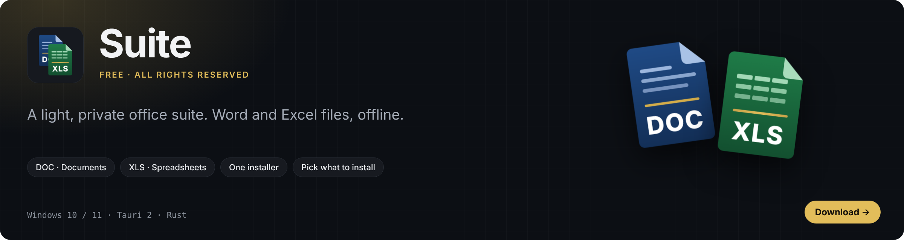

  &nbsp;
  &nbsp;
  

 

## Overview

Suite is a light office suite for Windows 10 and 11. It contains two apps, and you choose which ones to install:

| | |
|:--|:--|
| **DOC** | Word processor. Opens and saves Word files with their formatting: tables, images, equations, track changes, comments, PDF export, mail merge. Formats: `.docx` `.docm` `.dotx` `.doc` `.odt` `.rtf` `.pdf` `.md` `.htm` `.txt` |
| **XLS** | Spreadsheets. Opens and saves Excel files with their formulas: charts, pivot tables, filters, conditional formatting, get & transform data. Formats: `.xlsx` `.xlsm` `.xltx` `.xls` `.ods` `.csv` `.tsv` |

No account, no ads, no telemetry. Your files stay on your computer, and each app keeps itself up to date. Macros are off by default.

## Install

1. Download **Suite_Setup.exe** (about 200 KB). It downloads only the apps you pick, in their latest version.
2. Tick **DOC**, **XLS** or both.
3. Press **Install**. No administrator rights needed.

No internet on that computer? Use **Suite_Setup_Offline.exe** (about 18 MB), which contains both apps.

Found a problem? [Open an issue](https://github.com/vasileiostripolidis/suite-releases/issues).

---

### 🇬🇷 Ελληνικά

Η **Suite** είναι μια ελαφριά σουίτα γραφείου για Windows με δύο εφαρμογές: το **DOC** για κείμενα (ανοίγει και αποθηκεύει αρχεία Word) και το **XLS** για υπολογιστικά φύλλα (ανοίγει και αποθηκεύει αρχεία Excel). Κατεβάζεις ένα αρχείο εγκατάστασης και διαλέγεις τι θα εγκατασταθεί. Δουλεύουν χωρίς internet, χωρίς λογαριασμό και χωρίς παρακολούθηση, και ενημερώνονται μόνες τους.

**[Λήψη για Windows](https://github.com/vasileiostripolidis/suite-releases/releases/latest/download/Suite_Setup.exe)** · [Χωρίς σύνδεση](https://github.com/vasileiostripolidis/suite-releases/releases/latest/download/Suite_Setup_Offline.exe) · [Σελίδα](https://vasileiostripolidis.github.io/suite-releases/)

© 2026 Τριπολίδης Βασίλειος. Free to use, all rights reserved. The source code is private.
