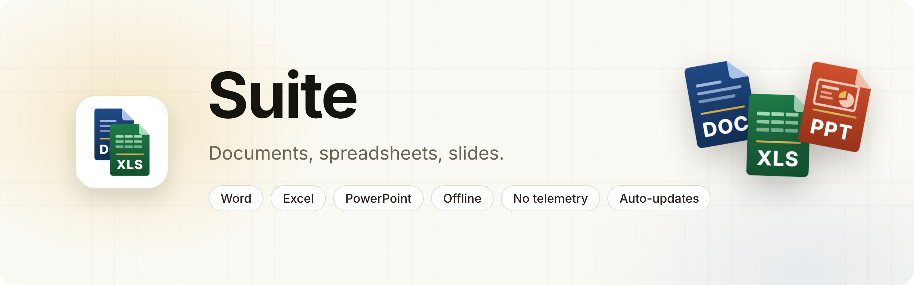
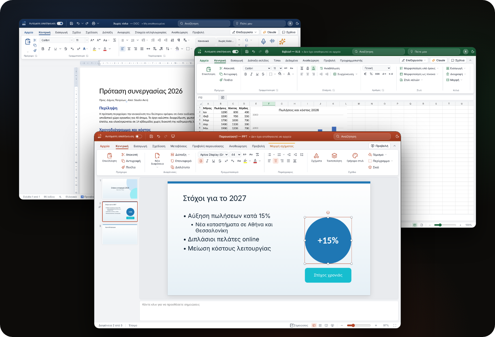
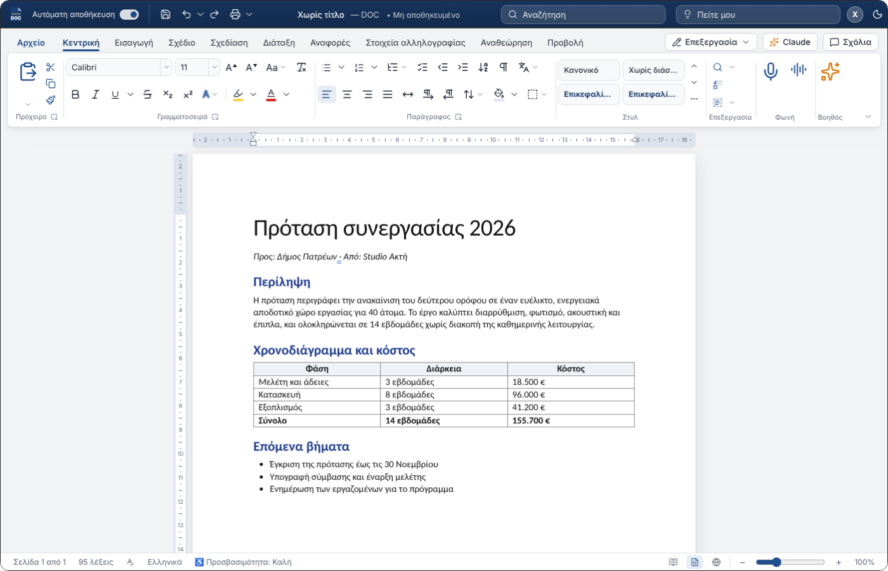
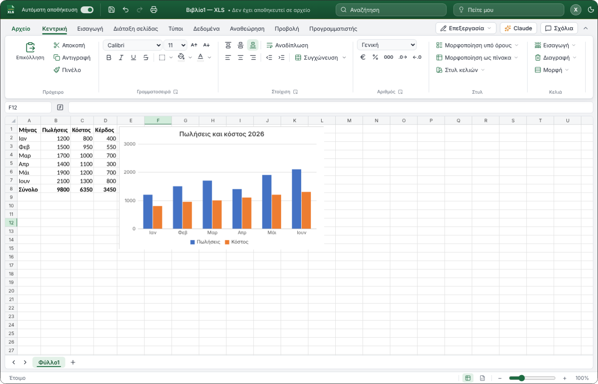
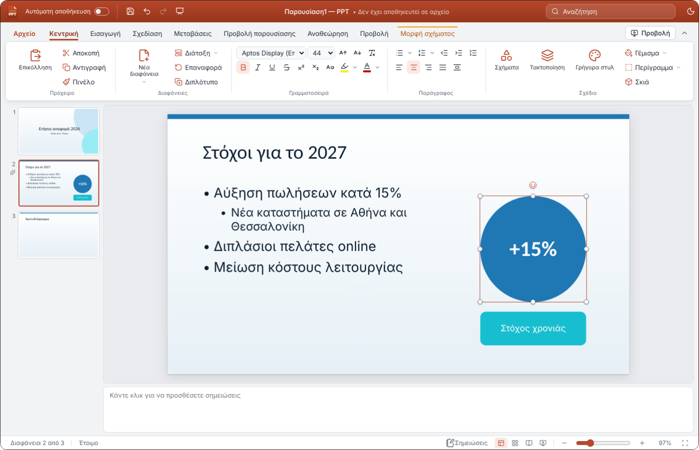

<picture>
  <source media="(prefers-color-scheme: dark)" srcset="./.github/assets/banner-dark.png">
  
</picture>

  &nbsp;
  &nbsp;
  

  <a href="https://github.com/vasileiostripolidis/suite-releases/releases">
    <picture>
      <source media="(prefers-color-scheme: dark)" srcset="https://github.com/vasileiostripolidis/suite-releases/raw/site/stats/downloads-dark.svg">
      
    </picture>
  </a>

  <picture>
    <source media="(prefers-color-scheme: dark)" srcset="./.github/assets/stack-dark.png">
    
  </picture>

 

 

## Overview

Suite is a light office suite for Windows with three apps: **DOC** for documents, **XLS** for spreadsheets and **PPT** for presentations. One small installer asks which ones you want and installs only those. They open and save Microsoft Office files, run without an internet connection and keep themselves up to date; updating one updates the others too.

|  |  |
|:--|:--|
| **~200 KB** installer | Downloads only the apps you pick; the offline installer carries all three |
| **0** telemetry | No account, no ads, no analytics. Files stay on your computer |
| **3** apps | DOC, XLS and PPT, installed together or on their own |
| **21** file formats | Word, Excel, PowerPoint, OpenDocument, RTF, PDF, Markdown, HTML, CSV and more |
| **0** admin rights | Installs per user; no UAC prompt |

 

## The apps

<table>
<tr>
<td width="50%" valign="top">

#### DOC · documents
Opens and saves Word files with their formatting. Styles, tables, images, shapes and equations; headers, footers and page layout; spell check, track changes and comments; mail merge, templates and PDF export. Greek and English interface.

`.docx` `.docm` `.dotx` `.dotm` `.doc` `.odt` `.rtf` `.pdf` `.xps` `.md` `.htm` `.txt`

</td>
<td width="50%" valign="top">

#### XLS · spreadsheets
Opens and saves Excel files with their formulas. Charts, pivot tables, slicers, filters and conditional formatting; get & transform data and a data model; track changes, themes and personal templates.

`.xlsx` `.xlsm` `.xltx` `.xltm` `.xls` `.ods` `.csv` `.tsv`

</td>
</tr>
<tr>
<td colspan="2" valign="top">

#### PPT · presentations
Opens and saves PowerPoint files. Slide layouts and themes, text with bullets and numbering, shapes, pictures, icons and tables; speaker notes, transitions, slide show with presenter view, and PDF export.

`.pptx` `.pptm` `.ppsx` `.potx`

</td>
</tr>
</table>

<table>
<tr>
<td width="50%"></td>
<td width="50%"></td>
</tr>
<tr>
<td align="center"><b>DOC</b>: a proposal with headings, a table and a list</td>
<td align="center"><b>XLS</b>: formulas and a chart that follows the data</td>
</tr>
<tr>
<td colspan="2"></td>
</tr>
<tr>
<td colspan="2" align="center"><b>PPT</b>: slides with a theme, bullets and shapes</td>
</tr>
</table>

 

## Install

1. Download **[Suite_Setup.exe](https://github.com/vasileiostripolidis/suite-releases/releases/latest/download/Suite_Setup.exe)** and open it.
2. Tick **DOC**, **XLS**, **PPT**, or any combination.
3. Press **Install**. The apps appear in the Start menu.

| Installer | Size | When to use it |
|:--|:--|:--|
| `Suite_Setup.exe` | ~200 KB | Normal choice. Fetches the latest version of the apps you pick |
| `Suite_Setup_Offline.exe` | ~25 MB | Computers without internet, or a copy to keep on a USB stick |

Windows 10 / 11, 64-bit. The installers are not code-signed yet, so SmartScreen may ask once: *More info → Run anyway*. Run the installer again any time to add another app.

**Updates:** each app checks for new versions by itself and installs them only after you confirm. Updating one app also updates the other installed apps (an open app is updated as soon as you close it). Updates are signed with an Ed25519 key; an unsigned or altered package is rejected. Documents and settings are kept.

 

<b>Security and privacy</b>

 

| | |
|:--|:--|
| Network | No telemetry. The only automatic request is the optional update check against this repository |
| Macros | Off by default, as in Office. Macro code has no access to the system |
| Files | Your documents never leave your computer |
| AI assistant | Optional. Works only if you add your own API key, and only when you ask it |
| Updates | Signed (minisign / Ed25519), never installed without confirmation |

Found a problem? [Open an issue](https://github.com/vasileiostripolidis/suite-releases/issues).

 

---

### 🇬🇷 Ελληνικά

Η **Suite** είναι μια ελαφριά σουίτα γραφείου για Windows με τρεις εφαρμογές: το **DOC** για κείμενα (αρχεία Word), το **XLS** για υπολογιστικά φύλλα (αρχεία Excel) και το **PPT** για παρουσιάσεις (αρχεία PowerPoint). Κατεβάζεις ένα μικρό αρχείο εγκατάστασης και διαλέγεις τι θα εγκατασταθεί. Δουλεύουν χωρίς internet, χωρίς λογαριασμό και χωρίς παρακολούθηση, και ενημερώνονται μόνες τους· η ενημέρωση της μίας ενημερώνει και τις άλλες.

**[Λήψη για Windows](https://github.com/vasileiostripolidis/suite-releases/releases/latest/download/Suite_Setup.exe)** · [Χωρίς σύνδεση](https://github.com/vasileiostripolidis/suite-releases/releases/latest/download/Suite_Setup_Offline.exe) · [Ιστοσελίδα](https://vasileiostripolidis.github.io/suite-releases/)

© 2026 Τριπολίδης Βασίλειος. Free to use, all rights reserved. The source code is private.
