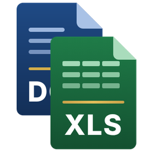

# Suite — Λήψεις

Ένα πρόγραμμα εγκατάστασης για όλες τις εφαρμογές. Επιλέγεις ποιες θέλεις και εγκαθίστανται μόνο αυτές.

| Εφαρμογή | Τι είναι |
|---|---|
| **DOC** | Επεξεργαστής κειμένου, συμβατός με αρχεία `.docx` |
| **XLS** | Υπολογιστικό φύλλο, συμβατό με αρχεία `.xlsx` |

**[⬇ Suite_Setup.exe](https://github.com/vasileiostripolidis/suite-releases/releases/latest/download/Suite_Setup.exe)** — μικρό αρχείο· κατεβάζει την τελευταία έκδοση μόνο των εφαρμογών που επιλέγεις (χρειάζεται Internet).

**[⬇ Suite_Setup_Offline.exe](https://github.com/vasileiostripolidis/suite-releases/releases/latest/download/Suite_Setup_Offline.exe)** — περιέχει όλες τις εφαρμογές· για υπολογιστές χωρίς σύνδεση.

Κάθε εφαρμογή εγκαθίσταται με το δικό της πρόγραμμα, οπότε:
- ενημερώνεται αυτόματα, όπως και όταν την κατεβάζεις χωριστά·
- απεγκαθίσταται χωριστά από *Ρυθμίσεις → Εφαρμογές*·
- αν είναι ήδη εγκατεστημένη, το Suite την ενημερώνει στην τελευταία έκδοση.

Μεμονωμένες λήψεις: [DOC](https://github.com/vasileiostripolidis/doc-releases) · [XLS](https://github.com/vasileiostripolidis/xls-releases)

Σιωπηλή εγκατάσταση (για διαχειριστές): `Suite_Setup.exe /S /APPS=doc,xls`

---
Οι εφαρμογές δεν σχετίζονται με τη Microsoft. Τα «Word» και «Excel» είναι εμπορικά σήματα της Microsoft Corporation.
